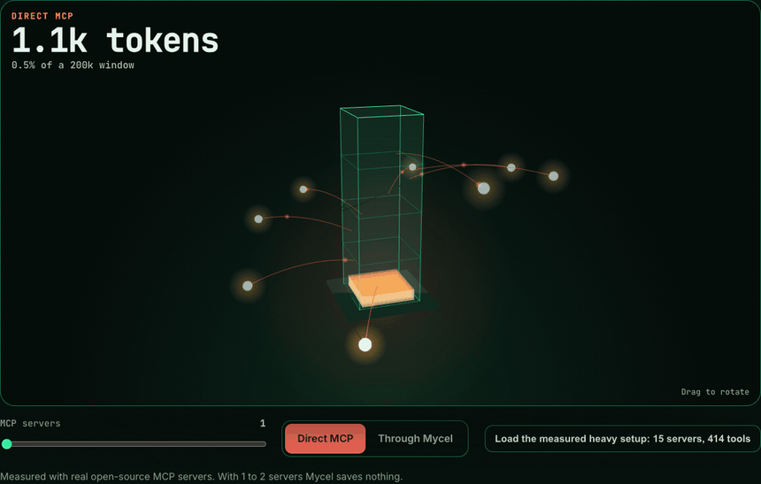
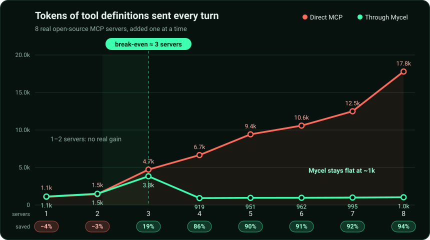
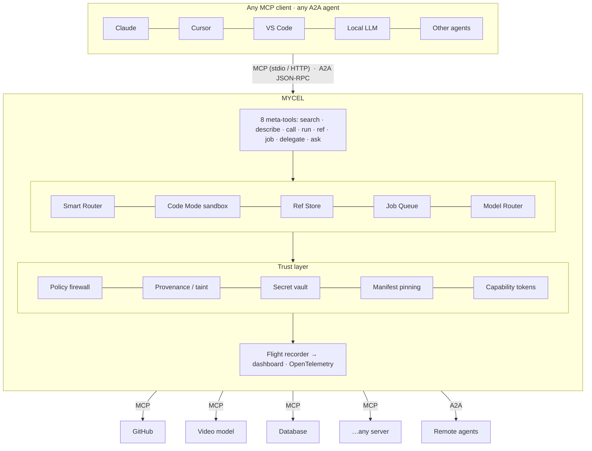

<div align="center">

<a href="https://mycel.speakquery.ai/#film"></a>

<sub>The film is a dramatization. Its 500 MB video example with transcript uses illustrative data (video/data.json); today the built-in video digest returns metadata and keyframe refs, no transcript. The film's final frame shows an outdated command; the correct one is <code>npx @speakquery/mycel init</code> (the package is published as @speakquery/mycel).</sub>

# Mycel

### One layer between your agents and everything they touch.

**A drop-in MCP gateway + agent-to-agent mesh.**
Your existing MCP setup — minus the context bloat, the round-trip storms and the blind trust.

[](LICENSE)
[](package.json)
[](https://modelcontextprotocol.io)
[](https://a2a-protocol.org)
[](tests)

[**▶ Watch the 90-second film**](https://mycel.speakquery.ai/#film) · [Quickstart](#-quickstart) · [Benchmark](#-the-numbers) · [How it works](#-how-it-works) · [All 20 features](#-features) · [Docs](docs/)

</div>

---

<div align="center">



</div>

| Same job | Normally | With Mycel | Change | Conditions |
|---|---:|---:|:---:|:---|
| Find one bad row in a 20,000-row spreadsheet | 12 turns · 34.5 s · ~130k tokens read · $0.0151 | 4 turns · 6.6 s · ~26k tokens · $0.0029 | **−81%** | Claude Code, Haiku, cache off, single run (n=1). [Details](#measured-in-a-real-claude-code-session-single-run-n1) |
| Design 6 app screens with Google Stitch and save one to your project | $0.087 · ~147k chars of results · model re-typed 26 KB of HTML (and corrupted it) | $0.013 · ~18k chars · passed a 318-char reference · same 13 turns | **−85%** | Real Stitch, Claude Code Haiku, n=1, Mycel 0.1.7. [Details](#second-real-session-ui-design-with-google-stitch-single-run-per-arm-n1) <!-- STITCH-0.1.7 --> |
| Check 50,000 rows of data for 3 hidden errors | 583,980 tokens | 602 tokens | **~970× less** | Independent review, mock data, scripted, 3/3 correct both ways. [Details](#-who-is-it-for) |
| Connect 15 MCP servers (420 tools) | ~204k tokens of tool descriptions before you type (a full 200k window) | 1,338 tokens | **−99.3%** | Clients that send every tool description each turn; Claude Code and recent Cursor load tools on demand. [Reproduce](examples/full-scale) |

*With 1–2 small servers Mycel costs more context, not less — it pays off with many tools and big results.* [How it works ↓](#-how-it-works)

---

```bash
npx -y @speakquery/mycel setup   # finds your MCP servers, shows what changes, backs up, connects them
```

<sub>macOS, Linux, Windows, Node 20+. Restart your app afterwards. `mycel undo` restores your original settings.</sub>

> **Is Mycel a new protocol?** No — and that's the point. Mycel speaks plain **MCP** to your client and plain **MCP** to your servers, so nothing has to change on either side. It also speaks **A2A** so other agents can use your tools under the same rules. Think of it as the missing middle layer both protocols assumed someone else would build. Tools work without client changes; resources and prompts parity is not yet verified.

> **Big MCP results stay local.** Your agent reads the line it needs and passes the file to the next tool by reference, instead of pushing 20,000 rows through the model. Code Mode lets it do a multi-step chore in one script.

### Measured in a real Claude Code session (single run, n=1)

Task: "find the one rare row in a 20,000-row CSV". Both arms found the right row. Claude Code 2.1.316, model `claude-haiku-5-5`, built-in tools off.

| Condition | Direct MCP | Through Mycel |
|---|---:|---:|
| Cache off | 12 turns · 34.5 s · 124,770 input + 5,219 output tokens (CLI est. $0.0151) | **4 turns · 6.6 s · 25,915 input + 574 output (CLI est. $0.0029)** |
| Cache on | 7 turns · 22.6 s | **5 turns · 7.0 s** |

This is one run per cell, not a statistical result. To be fair about the other side:

- **Small files cost about one extra turn.** On "find a decision in a small file" (cache on) direct took 3 turns / 5.2 s and Mycel 4 turns / 6.0 s.
- **Write tasks stopped for approval** in a non-interactive client. That is by design; pre-approve writes for headless use (see [Configuration → policy](docs/configuration.md#policy)).
- In non-interactive clients (no MCP elicitation) nobody can approve inline. Pre-approve with a rule above the approving rule, e.g. `policy: [{ match: { tool: "github.add_label" }, action: allow }]` or `{ match: { server: "github", effect: write }, action: allow }`. Rules are first-match-wins.
- Some clients (for example Claude Code in print mode) turn an approval request into their own denial, so the model sees "denied by the user" instead of Mycel's how-to-approve text. For headless use, pre-approve via policy.
- A run with a 1.7B local model completed no task in either arm; small models also confused ref handles with file paths, and the error now explains the ref format. We make no speed or success claim from it.
- Protocol for running your own comparison: [docs/benchmark-protocol.md](docs/benchmark-protocol.md).

### Second real session: UI design with Google Stitch (single run per arm, n=1)

Task: with the real Google Stitch MCP, create a project, generate 6 mobile screens for a food-delivery app (login, home, menu, cart, checkout, order tracking), then save the checkout screen's HTML to `payment.html` through the filesystem server. Claude Code, model `claude-haiku-5-5`, 2026-11-27, identical prompts in both arms. Both arms completed 6 screens; the Mycel arm's saved file is byte-identical to Stitch's checkout HTML, the direct arm's is not (see below).

| | Direct MCP (run 2) | Mycel 0.1.6 (run 1) | Mycel 0.1.7 (run 2) | Verdict (0.1.7 vs direct) |
|---|---:|---:|---:|:---|
| 💰 CLI cost | $0.0867 | $0.0221 | **$0.0132** | −85% ✅ |
| 📦 Tool results in context | 147,455 chars (~36.9k tokens) | 24,632 chars | **18,289 chars (~4.6k tokens)** | −88% ✅ |
| 🎨 Data returned by the 6 generations | 120,584 chars | 2,028 chars | **8,863 chars** (ref + digest, inline) | −93% ✅ |
| 💾 Saving the HTML | model re-typed 26,436 chars | `ref://` handle, 317 chars | **`ref://` handle, 318 chars** | −99% ✅ |
| ✍️ Output tokens | 14,899 | 6,950 | **4,014** | −73% ✅ |
| 📥 Total input incl. cache | 901,571 | 1,212,217 | **549,084** | −39% ✅ |
| 🔁 Turns | 13 | 27 | **13** | equal ✅ |
| ⏱️ Wall time | 17.1 min | 16.1 min | **15.6 min** | −9% (within noise) ✅ |
| 🎯 Oracle: `payment.html` identical to Stitch's HTML | ❌ **corrupted**: dropped one character (U+F8FF before "Pay") and added a trailing newline while re-typing | ✅ byte-identical | ✅ **byte-identical** | ✅ |

**The corruption is a concrete reason refs matter:** in run 2 the direct arm's model re-typed ~25 KB of HTML into `write_file` and silently dropped one private-use glyph (U+F8FF, the Apple-logo glyph before "Pay") and appended a trailing newline, so the saved file no longer matched Stitch's. The Mycel arm passed a 318-char `ref://` handle and the file was byte-identical. (n=1, but it happened; in run 1 the direct arm's file matched after trimming.)

Variance note: direct run 1 (same task and hints) used 13 turns, 13.6 min, $0.0950, 140,819 chars of tool results and re-typed 30,509 chars; Mycel 0.1.6 run 1 is the middle column. Different designs and call sequences between runs: LLM variance is not controlled.

Scripted check of the same 6-screen project (no model): ~48.3k tokens direct vs ~3.0k through Mycel (−94%); tool definitions: 32 raw tools (~15,118 tokens) vs 6 meta tools (~915).

#### Secondary: turn fix on a mock service (mock service, n=2)

| Run 1 · run 2 | Direct | Mycel 0.1.6 | Mycel 0.1.7 |
|---|---:|---:|---:|
| 🔁 Turns | 15 · 13 | 30 · 31 | **15 · 13** |
| 💰 CLI cost | $0.122 · $0.111 | $0.026 · $0.020 | **$0.014 · $0.012** |
| ✍️ Output tokens | 16.1k · 16.1k | 10.5k · 6.5k | **4.5k · 3.6k** |
| 📦 Tool-result chars | 127.7k · 126.4k | 24.2k · 20.1k | **16.4k · 12.1k** |
| 📥 Total input incl. cache | 1,106k · 892k | 1,353k · 1,126k | **616k · 525k** |
| ✔️ Oracle (file saved, byte-identical) | 2/2 | 2/2 | 2/2 |

Honest limits: the mock table uses a mock service with fixed 22–38 s generations, so its wall time is not meaningful. Real-service tables are n=1 per arm, the designs differed between arms (not a quality comparison), and 0.1.7 results are returned as ref + digest (~1.5 KB each) inline, so its gain over 0.1.6 is mainly fewer turns, not smaller payloads.

- **Gained:** real run 2 vs direct: cost −85%, tool results in context −88%, output tokens −73%, total input −39%, turns equal (13 vs 13), and the HTML saved by handle, byte-identical, where the direct arm's re-typed copy was corrupted. Versus Mycel 0.1.6: turns 27 → 13, no job polling.
- **Lost:** nothing measurable against direct in run 2. The remaining avoidable cost is one verification read after the write (the minimum for this task is about 10 calls; run 2 used 12). Wall time is dominated by Stitch generation latency.

Stitch needs `MCP_TOOL_TIMEOUT=1200000`, and the run used a policy that allows the stitch and filesystem servers and denies `delete_project`, `apply_design_system` and `update_design_system`. Setup, prompt, the full tables and how to reproduce: [docs/case-studies/stitch-ui-design.md](docs/case-studies/stitch-ui-design.md).

<p align="center"></p>

<p align="center"><b>▶ Try the interactive savings calculator and 3D view → <a href="https://mycel.speakquery.ai/#calculator">https://mycel.speakquery.ai/#calculator</a></b></p>
<p align="center"><a href="https://mycel.speakquery.ai/#why"></a> <a href="https://mycel.speakquery.ai/#calculator"></a></p>

<h1 align="center">Why use it?</h1>

<h3 align="center">Because every agent with many tools drowns in its own plumbing.</h3>

<p align="center"></p>

- 🧠 **Context bloat.** In clients that send every tool definition on every turn, that is 17.9k tokens for 8 servers and ~204k for 420 tools. Those are tool-definition tokens (~4 chars per token), reproducible offline: [examples/full-scale](examples/full-scale). Less room for your actual work, worse tool choice. Check your client: Claude Code and recent Cursor load tool descriptions on demand.
- 🚚 **Everything flows through the model.** 10,000 rows from tool A to tool B means 10,000 rows in the prompt.
- 🔁 **Round-trip storms.** A 17-step chore means up to 17 inference turns when the client makes one tool call per turn.
- 🎭 **Blind trust.** A web page can tell your agent to write to disk or send your keys; a server can silently rewrite a tool description.
- 🎬 🔑 🕳️ **No home for long jobs, no scoped delegation, no black box.** Video renders time out mid-call, sub-agents inherit every key, and nobody can see what the agent did or what it cost.

<h1 align="center">What do you gain?</h1>

<h3 align="center">Fewer round trips. Big data stays out of the prompt. Unsafe actions get stopped.</h3>

<p align="center"></p>

- ⚡ **17 calls, 1 round trip.** The model writes one small script; Mycel runs it in a WebAssembly sandbox and returns only the result (about +0.4 ms on a Mac, +1 ms in CI (Ubuntu, Windows); median of 15 local calls). 17 tool calls in 1 model round trip. A client that makes one tool call per turn needs 17 turns; an efficient direct path using batch tools (read_multiple_files) needs about 3. Code Mode assumes the model writes a working script first time; not yet measured with a live model.
- 📦 **Refs instead of payloads.** A 20,000-row CSV becomes a reference plus a digest: 131k tokens → 187. The model can still ask for rows or hand the ref to another tool.
- 🛡️ **Safe by default.** Untrusted content can't trigger a write without approval, secrets referenced as `{{secret:NAME}}` are injected by Mycel and scrubbed from outputs, errors and traces, and changed tool definitions are blocked.
- 👁️ **Calls are recorded.** Every tool request that reaches Mycel's MCP server gets a span, including failures, unknown tools, invalid refs and dry runs (not covered: client-side actions, provider-side effects, requests rejected before they reach Mycel; money is read from the budget ledger, not the traces); budgets, approvals and a live dashboard; sub-agents get narrowed capability tokens, never your keys.

<p align="center"></p>

<h1 align="center">How much do you save?</h1>

<h3 align="center">1–2 small servers: it costs more. 8 servers (eager loading): ~93.5%.</h3>

<p align="center"></p>

- 📉 **8 servers: 17.9k → 1.16k tokens per turn (−93.5%)**, and a 30-turn session drops from 536k to ~35k. This applies where the client sends every definition each turn; it is not measured on Claude Code or Cursor, which load tools on demand.
- 🧰 **Big setups (technical):** 9 servers with Canva is 44.5k → 1.05k. The 99.3% figure is for 420 tools loaded up front; see [the technical note](#at-full-scale-420-tools-technical).
- 🔁 **Reproducible:** the −93.5% with 8 servers is reproducible: examples/field-test (CI runs it on Ubuntu and Windows).
- 📄 **Big results:** a 20,000-row CSV is 131k → 187 tokens.
- ⚖️ **The honest part:** with 1–2 small servers Mycel costs more context (about 58% more on a 4-tool catalog with a real tokenizer). Do not use it for that; use it for refs, Code Mode or the safety layer. Details: [Do you need Mycel?](#-do-you-need-mycel)

## 👥 Who is it for?

Eleven sectors, each with an honest status. The evidence is a mock or scripted setup with a small n, not a field result. Local, single-user, read-heavy use is the recommended pilot; paid jobs with automatic fallback are not.

> **Statuses:** MEASURED = run end-to-end with recorded results; PARTIAL = parts tested with mocks/scripts; DESIGNED FOR = not yet tested. Want your sector tested? [Open an issue](https://github.com/SpeakQuery/mycel/issues/new) — pilot plan in [docs/benchmark-protocol.md](docs/benchmark-protocol.md).

| # | Sector | What Mycel does for you | Status |
|---:|---|---|---|
| 1 | 🔬 Researchers and data analysts | A 20,000-row CSV becomes a ref plus a digest; a Code Mode scan finds what a text search missed. | MEASURED (with caveat) |
| 2 | 🧑‍💻 Developers with many MCP servers | 8 servers, 80 tools: 17.9k → 1.16k definition tokens where the client sends them all. | PARTIAL |
| 3 | 📣 AI editors and content/marketing teams | Find designs, read assets by ref; publish or send needs approval under the example policy. | PARTIAL |
| 4 | 🎬 Video / voice producers | Refs between agents, budget caps and jobs for slow renders; automatic paid fallback not yet recommended. | PARTIAL (pilot) |
| 5 | 🎧 Customer-support agents | Untrusted customer text can’t trigger a refund or an email without approval. Evidence (independent review, mock services, 3 runs each): scripted runs 3/3 produced the right draft; a 1,800-line ticket history stayed as a ref; all 6 injected refund/email attempts stopped for approval (0 unapproved side effects, 0 unnecessary approvals). With a small local model (Qwen3-4B) 0/3 reached the right end state (wrong order id, no draft): a model limit, no Mycel-specific failure. Note: approval for trusted external actions (email, share, upload) requires an explicit `{ match: { effect: external }, action: approve }` rule; the default policy allows them. | PARTIAL |
| 6 | 🛒 E-commerce operations | Bulk catalog and price changes in one script, with approval before anything goes live. Evidence (independent review, mock services, 3 runs each): scripted runs 3/3 corrected the three under-cost prices among 24,000 products, 0 false positives, and every price list waited for publish approval (explicit external→approve rule); the catalog never entered the model context. A small local model (Qwen3-4B) 0/3 (could not compare prices over the CSV, no draft). Note: approval for trusted external actions (publish, upload, send) requires an explicit `{ match: { effect: external }, action: approve }` rule; the default policy allows them. | PARTIAL |
| 7 | ⚖️ Legal / document review | Long contracts stay on disk as refs; clauses are found with grep and nothing leaves without approval. Evidence (independent review, mock services, 3 runs each): scripted runs 3/3 found all 3 changed clauses across two 36-page versions, 0 missed, 0 invented; with the explicit approval rule all 9 send attempts stopped. Small local model 0/3 (answered without opening the documents). Note: approval for trusted external actions (email, share, upload) requires an explicit `{ match: { effect: external }, action: approve }` rule; the default policy allows them. | PARTIAL |
| 8 | 📊 Finance & accounting reporting | Big ledger exports stay out of the prompt; paid data lookups are capped and every call is recorded. Evidence (mock services): scripted runs 3/3 found all three issues in 32,000 ledger rows; in every run the two mock provider receipts matched Mycel's ledger; a third call that would exceed the $0.10 budget cap was refused; the flight recorder had 18 of 18 tool calls. Small local model 0/3 (did not call the ledger/FX tools). | PARTIAL |
| 9 | 🛠️ Data engineering / ETL quality | Row-level checks run in Code Mode over refs, so mislabeled or unflagged records are found without reading the table. Evidence (independent review, mock services, 3 runs each): scripted runs 3/3 found all 3 issues in 50,001 rows, 0 false positives, both direct and through Mycel. Context size for the same 2-turn task: 583,980 tokens direct vs 602 through Mycel (requests + responses, chars/4). Local median latency 37.7 ms direct vs 319.3 ms Mycel. Small local model 0/3 in both arms. | PARTIAL |
| 10 | 📱 Agencies & social-media teams | Each agent gets its own narrowed token, so a posting agent can’t touch billing, and posts need approval. Evidence (mock pilot): scripted 3/3 and a real local model (Qwen3-4B) 3/3: with a posting-only capability token, billing calls were refused for every client, the analytics report travelled as a ref, and posting waited for approval (3 approval ids matched the queue; 0 unapproved posts). Measured with mock services; real platform APIs not tested. | MEASURED (mock pilot) |
| 11 | 🎨 UI/UX & product designers | Big design artifacts (generated screens, HTML) stay out of the model context and are saved by ref, not re-typed. Evidence (real Google Stitch MCP, Claude Code with `claude-haiku-5-5`, n=1 per arm): 6 mobile screens, Mycel 0.1.7, run 2 vs direct: CLI cost estimate $0.0867 → $0.0132 (−85%), tool results in context ~147k → ~18k chars, same 13 turns; the direct arm's re-typed `payment.html` was corrupted (one character dropped), the Mycel one byte-identical. See [the case study](docs/case-studies/stitch-ui-design.md). | **MEASURED (n=1, real service)** |

Also (DESIGNED FOR, not yet tested): education content, and health/biomedical literature review (arXiv/PubMed-style search; a reading aid, no medical-advice claims).

**Full scenarios for all 11 sectors → [docs/use-cases.md](docs/use-cases.md)**

Detail and evidence for the four sectors that have been tested:

### 🔬 1. Researchers and data analysts
**Badge: MEASURED (with caveat).**
- **Pain:** big CSV/SQL results and PDFs flowing through the prompt.
- **Lead story (measured, with a caveat):** in a 20,000-row dataset with two planted exceptions, a text search on the ref found one and missed the other; a Code Mode numeric scan over the ref found both. The model's first report omitted both until it was asked to verify against the file. **Lesson: verify against the full data; digests don't guarantee that every exception is seen.**
- **Earlier run (one run, cache off):** find the one rare row in a 20,000-row CSV: direct 12 turns / 34.5 s, Mycel 4 turns / 6.6 s.
- **Designed, not measured:** search arXiv, read papers by ref, hand the ref to a summarising tool.

### 🧑‍💻 2. Developers with many MCP servers
**Badge: PARTIAL.**
- **Pain:** git, filesystem, browser/Playwright, a database and docs (e.g. context7) in a client or agent framework that sends every tool definition up front.
- **Measured:** 8 servers, 80 tools: 17.9k → 1.16k definition tokens (chars/4). A scripted fix flow (git + browser + db) works.
- **Not working yet:** a model-written patch failed; Turkish search put the right tool in the top 3 in 0/5 queries (English is much better).
- **When NOT for you:** 1–2 small servers (Mycel costs more context there), or Claude Code/Cursor if all you want is definition savings.

### 📣 3. AI editors and content/marketing teams
**Badge: PARTIAL.**
- **Pain:** designs, docs and brand assets across many tools, and agents that can publish or send without a human looking.
- **Scenario:** Canva, a docs server and storage. The agent finds designs with `mycel_search` and reads assets by ref. With the example policy, a publish or send (an `external` effect) needs approval (inline or `mycel approve`), and a per-day budget cap is checked per call (for a job, once when it is queued, against the primary tool's price; nothing is reserved before dispatch, so concurrent paid jobs can exceed it).
- **Caveat:** in the mock publish test approval was needed only because of the example policy; the default policy allows a clean external call. The model also added unsourced claims to the text.

### 🎬 4. Video / voice producers running 5–6 agents
**Badge: PARTIAL (pilot).**
- **Pain:** media passed around as base64, renders that time out mid-call, every agent holding every key, a loop that quietly spends money.
- **Measured (mock pipeline):** a 5-agent mock pipeline worked: per-role tokens, refs passed between agents, the budget cap rejected the second, sequential request, and the final file had video and audio (5.000 s).
- **Real Higgsfield field report (n=1, 2026-11-27):** Mycel was the only path to the real Higgsfield MCP (remote URL + OAuth, 241 tools). Tool definitions for 270 tools: ~155k → ~962 tokens (−99.4%, *estimated*). Polling six renders with `mycel call` from a shell script cost **0 model tokens** per check vs ~85k for a subagent check (*measured*). The videos were submitted by another agent directly, so generation through Mycel is **not** measured yet. [Field report](docs/case-studies/higgsfield-video.md).
- **Not measured:** generating through Mycel vs direct, and Canva.
- **Not yet recommended:** automatic fallback across paid providers. After a paid request with an unknown outcome Mycel never falls back to another provider. It re-sends to the same tool only if that tool is `idempotent`, has `idempotencyKeyArg` (the same key is re-sent) and has retries left; otherwise it marks the job `unknown` and sends nothing more. The estimated charge is recorded once per (tool, key). A request is treated as rejected, and so may fall back, only when it is known not to have been accepted (connection refused before dispatch, or an error from a tool whose contract sets `errorsAreRejections: true`). After a restart, a job whose last request went to a paid tool resumes only if that tool is `idempotent` and has `idempotencyKeyArg`; otherwise it is marked `interrupted` and the estimate is charged once. This is not exactly-once: the provider must deduplicate (Mycel can pass a stable per-job key via `idempotencyKeyArg`). Attempts that the job queue sends are recorded in the job's `dispatches`; retries inside a single call's transport loop are not. On success the budget records the tool's declared `costUsd` for the call (the contract amount, not a provider invoice); otherwise it records the estimate, and `charged` in `dispatches` only means an estimate was written (a definite rejection writes none). A manual `mycel_job retry` of a job whose last paid dispatch is unresolved deliberately reuses the same idempotency key, so a deduplicating provider can collapse it into one receipt; per (tool, key) only one estimate is kept, and a later success replaces it with the actual charge (never both). Dispatches without a key are each charged. Reconcile paid jobs with the provider statement whatever their final status (not only `unknown` and `interrupted`; jobs recorded by 0.1.3 or earlier are not re-settled on upgrade) (there is no reconcile tool yet).

> **Pilot:** we're looking for 5 users (data analyst, data-quality engineer, developer with 5+ MCP servers, content editor, video/voice producer) — 45 minutes, your machine, paid actions mocked. [Open an issue](https://github.com/SpeakQuery/mycel/issues/new) to join.

**Run one of these and tell us:** [open an issue](https://github.com/SpeakQuery/mycel/issues/new) with your numbers (see [docs/benchmark-protocol.md](docs/benchmark-protocol.md)).

---

## 📊 The numbers

Measured by `mycel bench` — a reproducible in-process benchmark with 12 realistic servers (GitHub, Slack, Gmail, Calendar, Notion, Linear, Postgres, filesystem, browser, Drive, an AI media studio, Stripe test mode). Token counts use the same estimator (≈ 4 chars/token) on both sides.

| Scenario | Direct MCP | Through Mycel | Saved |
|---|---:|---:|---:|
| Tool definitions in context (167 tools) | **34.8k** tokens | **1.1k** tokens | **96.7%** |
| *"Label every stale issue"* (20 of 40) | 21 round trips · 6,071 tokens (computed, not a recorded session) | **1 round trip** · 77 tokens | **98.7%** |
| 5,000-row SQL result | 29.7k tokens | 156 tokens (digest + ref) | **99.5%** |
| 8 s 720p video (3.1 MB) | 1,068k tokens as base64 (won't fit) | 117 tokens (metadata + 3 keyframe refs) | **>99.9%** |
| Tool search, offline BM25 (20 English queries; see [search quality](#search-quality)) | — | top-1 **18/20** · top-3 **20/20** | — |

<sub>Methodology & caveats: [`src/bench.ts`](src/bench.ts). "Direct" counts only what the model must read; it ignores prompt caching, which lowers cost (not context size) for the direct case. The direct side of the 21-round-trip row is computed, not a recorded session. The offline index is English-only; see [search quality](#search-quality).</sub>

## 💰 What you actually save — worked examples

In a client that sends every tool definition on every turn, direct MCP re-sends all of them each time; Mycel stays flat at about 1.2-1.3k tokens. All numbers below are measured (see [Do you need Mycel?](#-do-you-need-mycel) and the [field test](#-field-test-8-real-mcp-servers)), except the dollar line, which is an illustrative assumption.

### 🖱️ Example 1: A client that sends every tool definition each turn: 8 servers, 30 turns

You connect 8 servers (80 tools). A client that sends all 80 definitions (**17.9k tokens**) with every turn spends **17.9k × 30 = 536k tokens** on definitions alone over 30 turns. Through Mycel the model sees ~1.16k tokens per turn (0.1.7): **1.16k × 30 ≈ 35k**. This is arithmetic (17.9k × 30), not a recorded session. Clients that load tools on demand spend less; see [Do you need Mycel?](#-do-you-need-mycel).

<p align="center"></p>

> 💵 *Illustrative assumption, not a measurement:* at $3 per million input tokens, before caching, that is about **$1.61 vs $0.10 per session**. Prompt caching lowers the price of the repeated definitions, but not the space they take in your context window.

### 🧰 Example 2: All 15 servers, 420 tools

Add Canva (44 tools) and Higgsfield (241 tools) to the others and direct MCP needs **~204k tokens of definitions** (tool-definition tokens (~4 chars per token), reproducible offline: [examples/full-scale](examples/full-scale)). In a client that sends them all up front, that is more than a 200k context window **before you type the first message**. Mycel: **~1.34k**. At 9 servers with Canva (126 tools) it is already 44.5k vs 1.05k (−97.6%).

<p align="center"></p>

### 📄 Example 3: Reading a 20,000-row CSV

Direct: the whole file flows through the model, **131k tokens**. Through Mycel the model gets a reference plus a digest (row count, columns, a sample): **187 tokens**. It can still ask for specific rows or pass the ref to another tool without ever reading the file.

### 🔁 Example 4: A 17-step chore, 17 calls in 1 round trip

"Find stale notes and save a report" is **17 tool calls in 1 model round trip** with Code Mode: the model writes one small script and Mycel runs it. A client that makes one tool call per turn needs 17 turns; an efficient direct path using batch tools (`read_multiple_files`) needs about 3. Code Mode assumes the model writes a working script first time; not yet measured with a live model. Per-call overhead of the gateway: **about +0.4 ms on a Mac, +1 ms in CI (Ubuntu, Windows); median of 15 local calls**. And the safe default holds: an untrusted web page trying to trigger `write_file` is **blocked and needs approval**.

**Where it does *not* help:** with 1–2 small servers Mycel costs more context (see below). Don't use it for that; use it for the safety layer, refs or Code Mode.

## 🤔 Do you need Mycel?

Honest answer: **it depends on how many MCP servers your agent uses.** Measured with 8 real open-source servers ([field test](examples/field-test)), adding them one at a time:

| MCP servers | Tools | Tool definitions, direct | Through Mycel | Context saved |
|---:|---:|---:|---:|---:|
| 1 | 3 | 1.1k tokens | 1.1k | **−4%** (costs more) |
| 2 | 4 | 1.5k | 1.5k | −3% (costs more) |
| 3 | 18 | 4.7k | 3.8k | 19% |
| **4** | **32** | **6.7k** | **0.9k** | **86%** |
| 6 | 42 | 10.6k | 1.0k | 91% |
| 8 | 80 | 17.9k | 1.16k | **93.5%** |

The table uses the chars/4 estimator. Rows 1-7 were measured on 0.1.x builds; the 8-server row is the current build (field-test S1: 17,882 → 1,160, −93.5%). With a real tokenizer (o200k) on a 4-tool catalog (time + fetch), direct is 902 tokens and Mycel 1,424: **Mycel uses about 58% more context there**. With 1–2 small servers, don't use it for context savings.

Mycel's own footprint stays flat at about 1.2-1.3k tokens. Direct MCP grows with every server you add, and on *every* turn the model re-reads all of those definitions.

**You'll feel it if…**
- you use **4+ MCP servers**, or one big one (Playwright, GitHub, Notion: 20–90 tools each);
- your tools return **big results**: files, tables, logs, page snapshots, images, video. A 20,000-row CSV is 131k tokens direct and 187 through Mycel;
- your agent does **many small steps** (read 15 files, decide, write): Code Mode does it in 1 round trip instead of up to 17 (about 3 with batch tools);
- your agent reads **untrusted content** (web, email, tickets) *and* can write, send or delete;
- you need to **see and cap** what agents do: approvals, budgets, an audit trail, or other agents (A2A) calling your tools.

**You probably don't need it if…** you run 1–2 small servers and only make short, read-only calls. Your client is fine on its own, and Mycel adds context there instead of saving it.

**Your client matters too.** Claude Code and recent Cursor versions load MCP tool descriptions on demand (Cursor calls it "dynamic context discovery"). In those clients the definition savings are smaller and not yet measured; Mycel's value there is Code Mode, refs for big results, the safety layer and A2A. Other clients and frameworks may send definitions up front: check your client. The numbers above apply in full only where every definition goes out every turn.

## 🔬 Field test: 8 real MCP servers

`cd examples/field-test && npm install && npm run setup && npm test` runs these checks on your own machine (macOS, Linux or Windows):

| # | Check | Result |
|---|---|---|
| S1 | Tool definitions in context (80 tools) | 17.9k → **1.16k** tokens (−93.5%) |
| S2 | Startup until tools are listed | about the same as direct (≈0.5–1.5 s) |
| S3 | Offline tool search, 16 natural-language queries | top-3 **15/16** (CI and local), top-1 **12/16** in the latest runs (English queries); see [search quality](#search-quality) |
| S4 | Per-call overhead (median of 15 local calls) | **about +0.4 ms** on a Mac, +1 ms in CI (Ubuntu, Windows) |
| S5 | 20,000-row CSV through `read_text_file` | 131k → **187** tokens (ref + table digest, grep-able) |
| S6 | "Find stale notes, save a report" (17 calls) | 17 calls in **1** round trip (Code Mode; not yet measured with a live model) |
| S7 | Web page (untrusted) → `write_file` | **blocked**, approval required |
| S8 | Browser automation (Playwright) | works, no needless prompts |
| S9 | Images, progress notifications | image → ref, 4/4 progress events forwarded |
| S10 | Risk classes for Playwright's 25 tools | 7 read · 13 external · 5 destructive |

### Search quality

On the 16-query English field test, top-3 is 15/16 (CI and local) and top-1 is 12/16 in the latest runs; the older "10/16" top-1 came from an earlier run and is superseded. On an independent 32-pair EN/TR set, raw BM25 finds the right tool in the top 3 for 20/32 English and 3/32 Turkish queries. When a small model (Haiku) chooses from the results and may rewrite the query once, it is correct on 27/32 English and 25/32 Turkish. The offline index itself is English-only; models usually search in English.

**Reproducibility:** the −93.5% with 8 servers is reproducible: examples/field-test (CI runs it on Ubuntu and Windows).

**Plus a real remote server with OAuth:** after `mycel login canva`, Canva's 44 tools work through Mycel, and the tokens refresh automatically. With Canva added, the lab holds 126 tools: **44.5k tokens of definitions direct, 1.05k through Mycel (−97.6%)**.

### At full scale: 420 tools (technical)

**Conditions:** 15 servers including Canva and Higgsfield (241 tools on its own), 420 tools loaded up front (eager loading). The tool definitions cost about **204k tokens direct and 1.34k through Mycel (−99.3%)** (203,547 → 1,338 on the current build, chars/4, see examples/full-scale; the earlier 0.1.6 figure was 1.2k, −99.4%). Real tokenizers agreed on 0.1.2, before the Mycel side grew to 1,338: cl100k 200,624 → 1,188 (99.41%), o200k 202,905 → 1,216 (99.40%). On a 135-tool catalog (no Canva/Higgsfield), o200k gives 29,129 → 1,147 (96.1%), and chars/4 overstates that one by about 19%. Claude Code and recent Cursor load tools on demand, and this is not measured there. Direct, that would fill most of a model's context window before the first message. These are tool-definition tokens (~4 chars per token), reproducible offline: [examples/full-scale](examples/full-scale). Counted the way clients send tools to the model: name, description and input schema. Canva and Higgsfield also ship output schemas; counting everything `tools/list` returns gives ~400k direct.

The field test found four real bugs before launch. All are fixed and covered by tests:
- Playwright marks even `hover` as destructive. Mycel now cross-checks that label against the tool's name (`annotations: strict` opts out).
- A big text result that came wrapped in JSON lost its table digest.
- grep on a single very long line returned the whole line.
- A few search synonyms were missing.

## 🚀 Quickstart

One line, Enter, done. Works on **macOS, Linux and Windows**. No Node.js? The installer brings its own (official build from nodejs.org, checksum verified, into `~/.mycel`, no admin rights).

**1. Paste one line**

macOS / Linux:

```bash
curl -fsSL https://mycel.speakquery.ai/install.sh | sh
```

Windows (PowerShell):

```powershell
irm https://mycel.speakquery.ai/install.ps1 | iex
```

Already have Node.js 20+? `npx -y @speakquery/mycel setup` does the same.

**2. Answer yes or no. The wizard does the rest.** Mycel finds the MCP servers you already use in Claude Desktop (including one-click extensions), Claude Code, Cursor, VS Code, Windsurf and Gemini CLI, shows exactly what it will change, backs everything up, and connects them through Mycel. You never edit a file or set a variable:

| Step | What the wizard does | You |
|---|---|---|
| 🔑 API keys | Moves them out of your app configs into `~/.mycel/secrets.env`, readable only by you (Mycel reads it; the model never sees the keys) | nothing |
| 🗝️ A key it could not find | Asks you to paste it; what you type is hidden | paste, or Enter to skip |
| 🧩 Claude Desktop extensions | Runs them through Mycel and turns them off in Claude Desktop (undo turns them back on) | nothing |
| 📁 Team project files (`.mcp.json`) | Asks before touching a file your team shares | yes / no |
| ✅ Test | Starts every server through Mycel and reports what works | nothing |
| 🌐 Sign-in (Canva, Notion, Higgsfield…) | Opens your browser for the one-time sign-in; tokens refresh automatically | yes, then "Allow" |
| 📊 Savings | Turns on a short savings line after each answer: tokens, %, ≈ $ and ≈ time | yes / no |
| 🔄 Restart | Restarts Claude Desktop / Cursor / Windsurf / VS Code for you on macOS (never the app it is running inside); tells you the one step left elsewhere | yes / no |

It ends with a summary: how many servers work, how many tools, and how much smaller the tool list is through Mycel. Claude Code plugins that bring their own MCP servers are listed and left alone (the plugin manages them).

**3. Done.** Your agent now finds tools on demand, keeps big results out of the chat, and asks before risky actions.

**See what you save:**

```
$ mycel stats
today: −48,300 tokens (measured result size, tokens ≈ chars/4) · tool definitions ~−202k/turn (estimated)
```

Changed your mind? `mycel undo` restores your original settings. Verified with test configs for each app; tell us if your setup looks different. Full walkthrough: [docs/getting-started.md](docs/getting-started.md).

### Manual setup

Prefer to do it by hand? `ffmpeg` is optional (video/audio digests). The servers you bring decide the rest. For example, Python-based servers need [`uv`](https://docs.astral.sh/uv/).

```bash
# Install (the command is `mycel`)
npm install -g @speakquery/mycel

# 1. Import the MCP servers you already use (secrets become {{secret:NAME}} placeholders)
mycel init

# 2. Check everything connects and see your own savings
mycel doctor
mycel bench

# 3. Remote servers with a sign-in (Canva, Notion, Linear, …): once per server
mycel login canva

# 4. Point your client at Mycel instead of N servers
```

`mycel init` skips only the Mycel entry itself and lists each skipped entry with the reason. `mycel doctor` exits 1 when any upstream fails to start.

<table>
<tr><th>Claude Code</th><th>Claude Desktop / Cursor / Windsurf / VS Code (<code>mcpServers</code>)</th></tr>
<tr><td>

```bash
claude mcp add mycel -- mycel serve
```

</td><td>

```json
{ "mcpServers": { "mycel": { "command": "mycel", "args": ["serve"] } } }
```

</td></tr>
</table>

Open **http://localhost:4747** for the live dashboard. Want the guided tour with real output? → [`examples/demo`](examples/demo).

## 🧬 How it works



The model sees **eight small meta-tools** instead of hundreds of schemas. A typical turn:

```text
mycel_search   {"query": "make a video from a prompt", "limit": 3}
  → [{"tool":"studio.generate_video","effect":"external","async":true,"costUsd":0.4,"schema":{"required":["prompt"],…}},…]
mycel_call     {"tool":"studio.generate_video","args":{"prompt":"a fox in neon rain"}}
  → (waits inline, up to 120 s by default, while the job runs; progress notifications keep the client alive)
  → {"status":"ok","result":{"ref":"ref://9c1e…","mime":"video/mp4","size":"48.2 MB",
       "digest":{"kind":"video","durationSec":8,"width":1920,"height":1080,"keyframes":["ref://…","ref://…","ref://…"]}}}
mycel_call     {"tool":"studio.upscale_video","args":{"video":{"$ref":"ref://9c1e…","as":"path"}}}

(A job id comes back only if the tool is still running after the inline wait: {"status":"job","job":{"id":"job_3f9…"}} → mycel_job {"action":"wait","id":"job_3f9…"}.)
```

48 MB of video moved between two tools. The model read ~120 tokens.

## ✨ Features

All 20 ship in v1. Every one is opt-in beyond the defaults, and a 10-line config works.

### Speed & context
| Feature | What it does |
|---|---|
| **1 · Smart Tool Router** | BM25 search (names ×3, server ×2, descriptions, params, synonyms) over every connected tool. Schemas load only on demand. Modes: `auto` (default — small catalogs get every tool directly plus `run`/`ref`/`job`; past ~4k tokens of definitions it switches to `meta`), `meta`, `hybrid` (meta-tools + your top-N most-used tools directly), `passthrough`. |
| **2 · Code Mode** | The model writes one async JS script; it runs in a **QuickJS WebAssembly sandbox** (no fs, no network, no Node APIs, CPU/memory/call caps). Only the return value comes back. `Promise.all` works. |
| **3 · Ref Store** | Content-addressed (`ref://<sha256>`) storage for anything big or binary, with model-sized **digests**: JSON shape + sample, table columns + stats, text outline, image/video/audio metadata, video keyframes (ffmpeg). Pass refs straight into tool args as text, JSON, base64, data URL or file path. |
| **4 · Job Queue** | Slow tools become jobs: progress, cancel, retry with backoff, **provider fallback chains**, resume after restart (a job whose last request went to a paid tool resumes only if that tool is `idempotent` and has `idempotencyKeyArg`; see the paid-jobs note below). |
| **5 · Cost & Budget** | Per-tool cost/latency contracts, `dryRun` estimates, per-task / per-day / per-token budget caps. Budget caps are checked per call; for a job the check runs once, when it is queued, against the primary tool's price, so fallbacks and manual retries get no separate pre-dispatch check and nothing is reserved: concurrent paid jobs can exceed a cap at the provider. Estimated charges count against the cap. Tools without a declared cost count as $0; set `costUsd` (alias `cost`) per tool for budgets to be meaningful. |
| **15 · Model Router** | `mycel_ask` hands self-contained sub-tasks (summarise, extract, classify) to a `fast`/`balanced`/`deep` tier — any OpenAI-compatible endpoint (Ollama, vLLM, LM Studio, OpenRouter…) or Anthropic. Refs in the prompt are expanded for the sub-model, not your main context. |

> **Paid jobs, honestly — not yet recommended for automatic fallback across paid providers.** After a paid request with an unknown outcome Mycel never falls back to another provider. It re-sends to the same tool only if that tool is `idempotent`, has `idempotencyKeyArg` (the same key is re-sent) and has retries left; otherwise it marks the job `unknown` and sends nothing more. The estimated charge is recorded once per (tool, key). A request is treated as rejected, and so may fall back, only when it is known not to have been accepted (connection refused before dispatch, or an error from a tool whose contract sets `errorsAreRejections: true`). After a restart, a job whose last request went to a paid tool resumes only if that tool is `idempotent` and has `idempotencyKeyArg`; otherwise it is marked `interrupted` and the estimate is charged once. This is not exactly-once: the provider must deduplicate (Mycel can pass a stable per-job key via `idempotencyKeyArg`). Attempts that the job queue sends are recorded in the job's `dispatches`; retries inside a single call's transport loop are not. On success the budget records the tool's declared `costUsd` for the call (the contract amount, not a provider invoice); otherwise it records the estimate, and `charged` in `dispatches` only means an estimate was written (a definite rejection writes none). A manual `mycel_job retry` of a job whose last paid dispatch is unresolved deliberately reuses the same idempotency key, so a deduplicating provider can collapse it into one receipt; per (tool, key) only one estimate is kept, and a later success replaces it with the actual charge (never both). Dispatches without a key are each charged. Fallback providers are tried automatically only when the failure is known to be a rejection (connection refused before dispatch, or an error from a tool whose contract sets `errorsAreRejections: true`). If you cancel after dispatch, Mycel charges an estimate. Reconcile paid jobs with the provider statement whatever their final status (not only `unknown` and `interrupted`; jobs recorded by 0.1.3 or earlier are not re-settled on upgrade).
>
> **Known limits for paid jobs:**
>
> - Estimates can exceed what the provider charged (for example when the provider never received the request): Mycel cannot tell "never accepted" from "reply lost" unless `errorsAreRejections` is set.
> - There is no reconcile tool yet (planned).
> - The dashboard "Spend today" mixes estimated and confirmed charges.
> - Jobs recorded by 0.1.3 or earlier are not re-settled on upgrade: compare earlier paid jobs, whatever their status, with the provider statement.
> - No pre-dispatch reservation: Budget caps are checked per call; for a job the check runs once, when it is queued, against the primary tool's price, so fallbacks and manual retries get no separate pre-dispatch check and nothing is reserved: concurrent paid jobs can exceed a cap at the provider. Estimated charges count against the cap.

### Trust
| Feature | What it does |
|---|---|
| **6 · Tool Contracts** | Every tool gets an effect class — `read` · `write` · `external` · `destructive` — plus idempotency, cost, latency, async. Inferred from MCP annotations and names (cautiously), overridable in config. |
| **7 · Policy Firewall** | Ordered YAML rules: `allow` / `deny` / `approve` by tool glob, server, effect or taint. Safe defaults: destructive → approve; tainted + side-effect → approve. |
| **8 · Provenance & Taint** | Output from `trust: untrusted` servers is labelled and **taint follows the data** — through refs and through code-mode scripts. A script that read a hostile web page can't quietly send email. |
| **9 · Secret Vault** | The model sees only the placeholder `{{secret:GITHUB_TOKEN}}`. Real values are injected at call time and scrubbed from outputs, errors and traces (a server that echoes a secret in an unusual encoding could still leak it). |
| **10 · Manifest Pinning** | Tool definitions are hashed into `mycel.lock`. If a server silently changes a tool's description or schema (a "rug pull"), the tool is blocked until a human runs `mycel pin --accept`. |
| **14 · Capability Tokens** | Macaroon-style, attenuable, expiring delegation tokens (`myc1.…`). A sub-agent can narrow its token — fewer tools, lower effect ceiling, smaller budget, shorter expiry — and hand it on, but can **never** widen it. No secret needed to attenuate. |
| **Approvals** | Inline via MCP **elicitation** when the client supports it; otherwise an approval id the human grants with `mycel approve <id>` or one click in the dashboard. Approvals are one-shot and bound to the exact arguments. |

### Visibility
| Feature | What it does |
|---|---|
| **11 · Flight Recorder** | Every tool request that reaches Mycel's MCP server gets a span (search, describe, call, run, ref, job, approval, policy decision, failures included; `describe`/`ref`/`job` spans hold ids and sizes, not content). Not covered: client-side actions, provider-side effects, requests rejected before they reach Mycel. Read money from the budget ledger: timing, measured tokens saved, bytes offloaded, cost, taint. JSONL on disk + **OpenTelemetry (OTLP/HTTP)** export. `mycel replay <trace>`. |
| **12 · Live Dashboard** | Local web UI: savings, live activity, trace waterfalls, approvals, jobs, servers, drift, refs. Token-protected and DNS-rebinding-safe. |

### Mesh & integration
| Feature | What it does |
|---|---|
| **13 · A2A Bridge** | Mycel *is* an A2A agent (Agent Card at `/.well-known/agent-card.json`, `message/send`, `tasks/get`, `tasks/cancel`) **and** an A2A client (`mycel_delegate` to your peers). Same policy, budget, taint and recording for agents as for MCP clients. |
| **16 · Universal import** | `mycel init` reads Claude Desktop, Claude Code (incl. per-project), Cursor, VS Code, Windsurf and Gemini CLI configs. |
| **17 · Both transports** | Serve over stdio (desktop clients) or Streamable HTTP (`/mcp`, remote clients; single-user, not a multi-tenant boundary). Upstreams over stdio or HTTP. |
| **18 · Python client** | `pip install "git+https://github.com/SpeakQuery/mycel#subdirectory=python"` — zero dependencies. |
| **19 · Benchmark** | `mycel bench` — the numbers above, reproducible on your machine. |
| **20 · Adapter SDK** | `defineAdapter({...})` turns ~50 lines into a provider (a new video model, an internal API) that works in-process *and* as a standalone MCP server. |

## ⚙️ Configuration

`mycel.yaml` (generated by `mycel init`):

```yaml
servers:
  github:
    command: npx
    args: ["-y", "@modelcontextprotocol/server-github"]
    env: { GITHUB_TOKEN: "{{secret:GITHUB_TOKEN}}" }
  canva:
    url: https://mcp.canva.com/mcp          # OAuth: run `mycel login canva` once; tokens refresh automatically
  studio:
    url: https://studio.example.com/mcp
    headers: { Authorization: "Bearer {{secret:STUDIO_KEY}}" }
    tools:                                  # contract overrides
      generate_video: { async: true, costUsd: 0.40, fallback: ["backup.generate_video"], retries: 1 }   # illustrative (tested against a mock provider); paid fallback is not yet recommended
  web:
    command: node
    args: ["./web-server.mjs"]
    trust: untrusted                        # its output is labelled and taints downstream calls

router:  { mode: auto }                     # auto | meta | hybrid | passthrough
policy:
  - match: { tool: "github.*delete*" }
    action: deny
  - match: { effect: destructive }
    action: approve
  - match: { tainted: true, effect: external }
    action: approve
    reason: Untrusted content is trying to send something out.
  - match: { effect: external }             # publish / send tools: a human approves each one
    action: approve
    reason: External effect (publish, send, post).
budget:  { perTaskUsd: 5, perDayUsd: 50 }
refs:    { inlineLimitBytes: 8000 }
sandbox: { timeoutMs: 30000, memoryMb: 64, maxToolCalls: 200 }
jobs:    { inlineWaitMs: 120000, concurrency: 4 }
recorder: { otlpEndpoint: http://localhost:4318 }   # optional
models:                                     # optional, enables mycel_ask
  fast:     { provider: openai, baseUrl: http://localhost:11434/v1, model: llama3.2 }
  balanced: { provider: anthropic, model: claude-haiku-5-5, apiKey: "{{secret:ANTHROPIC_API_KEY}}" }
a2a:                                        # optional
  tokenSecret: "{{secret:MYCEL_TOKEN_SECRET}}"
  peers:
    researcher: { url: https://research.example.com, token: "{{secret:RESEARCHER_TOKEN}}" }
```

Full reference: [`docs/configuration.md`](docs/configuration.md).

## 🧾 See what you save

Mycel can put a one-line summary after each tool call. It keeps two kinds of numbers apart, because only one of them is exact:

```
Mycel · this call −87% (≈13,240 → ≈1,710 tokens, measured) · session −48,300 tokens (−81%) ≈ $0.14 · ≈16 s (estimated) · tool definitions ~−202k/turn (estimated)
```

- **Measured (a size, not a token count).** The size of the raw result the upstream server returned vs the size Mycel actually returned to the model. The size is exact for what Mycel saw; the "tokens" are `chars / 4`, the same approximation used everywhere else, so they are marked `≈`. Real tokenizers differ: on one small body a reviewer saw 143 by this estimate against 223 from the Qwen tokenizer (up to ~55% apart), while on the 420-tool catalog cl100k and o200k agreed within about 2%. Read small figures as rough, large ones as a good guide. `_meta` carries `unit: "chars/4 tokens (approx.)"`. It covers `mycel_call`, direct tool calls in compact mode, and the inner calls of `mycel_run` (counted once, as the run). When Mycel returns *more* than the raw result (a small result plus its metadata) the line says `+N`, and it is subtracted from the session total, never counted as a saving. Calls that return an error, are denied or wait for approval have no measured figure.
- **Estimated.** What a client that sends every tool definition on every turn would pay for the catalog, minus what Mycel exposes. Mycel cannot see how many turns your client makes or whether it already loads tools on demand, so this is shown per turn and counted once per `tools/list` served. It only applies if your client sends every tool definition each turn (Claude Code and recent Cursor load tools on demand).

Where it shows (all on by default except the model-visible line):

| Where | What |
|---|---|
| Flight log | a `savings` field on each call (or job delivery, or run) event: `measured`, and `estimated` on `tools/list` events |
| Dashboard | a **Savings** panel: measured per call and session total; estimated shown separately, greyed, with the caveat |
| `mycel serve` | the line on stderr (`ui.savingsLog: false` to silence) |
| `mycel stats` | measured and estimated totals for the latest session and for today, printed separately (`--json` for scripts) |
| MCP result | `_meta: { "mycel/savings": { line, measured, session, estimated } }`, which most clients do not show to the model |
| Tool result text | **on after `mycel setup`** unless you answer no (off when you write the config by hand). Set `ui: { savingsLine: true }` to append the line as a last text block the model and you can see; with `ui.tellUser` (default on) the model also ends a finished task with the session savings for you. It costs about 30-40 tokens per call, so it is a small tax on the very thing it measures. |

The older `tokensSaved` counter (flight log, dashboard "Tokens saved", `mycel traces`, OTLP `mycel.tokens_saved`) now means measured savings only: it is never an estimate and does not double count `mycel_run` inner calls. The tool-definition estimate is reported separately.

**Money and time are estimates.** They convert measured saved tokens at `ui.usdPerMTok` (default $3 per million input tokens) and `ui.tokensPerSecond` (default 3,000 tokens/s of model reading). Set them to your model's price and speed; Mycel cannot see which model your app uses or what the run would have cost without it.

Known limits: results of async tools that outlive a restart have no raw size and show no measured figure; the raw size of image and audio results counts their base64 text, which overstates what a model would be charged for them; `session` means one gateway process.

## 🧪 Code Mode

```js
// mycel_run — one round trip instead of 21
const issues = await tools.call("github.list_issues", { repo: "acme/web", state: "open" });
const stale = issues.filter(i => daysSince(i.updated_at) > 30);
await Promise.all(stale.map(i => tools.call("github.add_label", { repo: "acme/web", issue: i.number, label: "stale" })));
return { labelled: stale.length };
```

Sandbox API: `tools.call(id, args)`, `tools.search(q)`, `refs.read(ref, {path, rows, grep, offset, length})`, `refs.put(value)`, `jobs.run(tool, args)`, `jobs.submit / wait`, `ask(prompt, {tier})`, `console.log`, `sleep`, `daysSince`, `chunk`, `pick`. Every `tools.call` goes through the same policy, budget, taint and recording as a direct call.

## 🤝 Agent to agent

```bash
export MYCEL_TOKEN_SECRET=$(mycel token secret)
mycel serve --http --port 4747                       # MCP at /mcp, A2A at /a2a

# Give a research agent read-only GitHub access for 2 hours, max $1 (a per-token cap checked per call, not reserved)
TOKEN=$(mycel token mint --tools 'github.*' --max-effect read --budget 1 --ttl 2h --sub researcher)
# …which it can narrow further for its own sub-agent — but never widen
mycel token attenuate "$TOKEN" --tools 'github.list_*' --ttl 10m --sub summarizer
```

```bash
curl -s localhost:4747/a2a -H "authorization: Bearer $TOKEN" -H 'content-type: application/json' -d '{
  "jsonrpc":"2.0","id":1,"method":"message/send",
  "params":{"message":{"kind":"message","role":"user","messageId":"1",
    "parts":[{"kind":"data","data":{"tool":"github.list_issues","args":{"repo":"acme/web"}}}]}}}'
```

A destructive request comes back as `input-required` with an approval id; after a human approves, the agent resumes the same task. See [`examples/a2a`](examples/a2a).

## 🐍 Python

```python
from mycel_client import Mycel, ApprovalRequired

m = Mycel("http://127.0.0.1:4747")
print(m.search("make a video"))
issues = m.call("github.list_issues", {"repo": "acme/web"})
print(m.run("return (await tools.call('github.list_issues', {})).length"))
```

## 🔌 Write an adapter

```js
import { defineAdapter, file } from "mycel";

export default defineAdapter({
  name: "my-video-model",
  tools: [{
    name: "generate_video",
    description: "Generate a video from a prompt",
    input: { type: "object", properties: { prompt: { type: "string" } }, required: ["prompt"] },
    effect: "external", async: true, costUsd: 0.4,
    async run({ prompt }, { progress }) {
      const id = await startRender(prompt);
      for (let p; (p = await poll(id)).status !== "done"; ) progress(p.percent, 100);
      return file(await download(id), "video/mp4", "out.mp4");   // becomes a ref:// with keyframes
    },
  }],
}).serve();                                                    // a standalone MCP server, too
```

## 🖥️ CLI

| Command | |
|---|---|
| `mycel setup` · `mycel undo` | one-step install: import servers, point clients at Mycel, with backups · restore them |
| `mycel init` | import client configs → `mycel.yaml` |
| `mycel serve [--http]` | run the gateway (stdio, or HTTP with `/mcp` + `/a2a`) |
| `mycel dashboard` | open the local dashboard |
| `mycel doctor` · `mycel bench` | check setup · measure savings |
| `mycel login <server>` | sign in to a remote MCP server that uses OAuth (Canva, Notion, Linear, …) |
| `mycel search <q>` · `mycel call <tool> [json]` · `mycel run <file>` | use tools from the terminal, same rules as agents |
| `mycel approvals` · `approve <id>` · `deny <id>` | human-in-the-loop |
| `mycel pin [--accept]` | review / accept tool-definition drift |
| `mycel token secret / mint / attenuate / inspect` | capability tokens |
| `mycel traces` · `mycel replay <id>` | flight recorder |
| `mycel stats [--json]` | measured and estimated token savings for the latest session and today |
| `mycel refs [--gc 7d]` | ref store |

## 🛡️ Security model — honestly

Mycel **reduces and exposes** risk; it does not "solve" prompt injection. What it aims to guarantee: secrets referenced as `{{secret:NAME}}` are injected by Mycel and scrubbed from outputs, errors and traces (a server that echoes a secret in an unusual encoding could still leak it); destructive and tainted side-effects need a human by default; changed tool definitions are blocked; delegated agents can't exceed their token; every tool call that passes through Mycel is recorded (not client-side actions or provider-side effects). What it can't guarantee: that a trusted server is actually trustworthy, or that a model never misreads data as instructions. Code Mode runs in QuickJS/WASM with no ambient capabilities, but treat it as defence in depth, not a security boundary for hostile code. Supported deployment is single-user and local; see the "Supported deployment" section of [SECURITY.md](SECURITY.md). Report issues: [SECURITY.md](SECURITY.md).

## 🗺️ Roadmap

- Streaming refs for realtime audio/video agents
- Embedding-based search as an optional plug-in (BM25 stays the offline default)
- A2A streaming (`message/stream`) and push notifications
- Signed tool manifests from server publishers
- Team mode: shared policy, approvals routed to Slack/Teams
- Fewer turns: long-running tools now wait inline (no `mycel_job` turn), narrow searches return input schemas and argument errors carry the schema (see CHANGELOG, Unreleased). Still planned: digests that surface the ids a model needs next, to avoid ref-read turns.

## Contributing

PRs welcome — see [CONTRIBUTING.md](CONTRIBUTING.md). `npm install && npm test` runs the full suite (117 tests) in a few seconds.

## 💚 Using Mycel? Show it

Mycel is **free** — for individuals, startups and large companies alike. No fees, no sign-up. We only ask for visibility:

1. **Keep the [NOTICE](NOTICE) file.** If you ship Mycel (or something built from it) inside your product, the Apache-2.0 license (section 4(d)) asks you to include the NOTICE text, e.g. in your third-party notices.
2. **Add the badge** (optional, but it helps the project a lot):

   [](https://github.com/SpeakQuery/mycel)

   ```markdown
   [](https://github.com/SpeakQuery/mycel)
   ```
   ```html
   <a href="https://github.com/SpeakQuery/mycel"></a>
   ```
3. **Tell us.** Using Mycel at your company or in a product? [Open an issue titled "Using Mycel at …"](https://github.com/SpeakQuery/mycel/issues/new?title=Using%20Mycel%20at%20) — we'd love to list you, and to hear what you need next. Interested in working with us on a pilot, support or a partnership? Same link.

Please don't name a derived product or service "Mycel"; "Powered by Mycel" is welcome.

## License

[Apache-2.0](LICENSE) · see [NOTICE](NOTICE) · © 2026 SpeakQuery and the Mycel contributors
