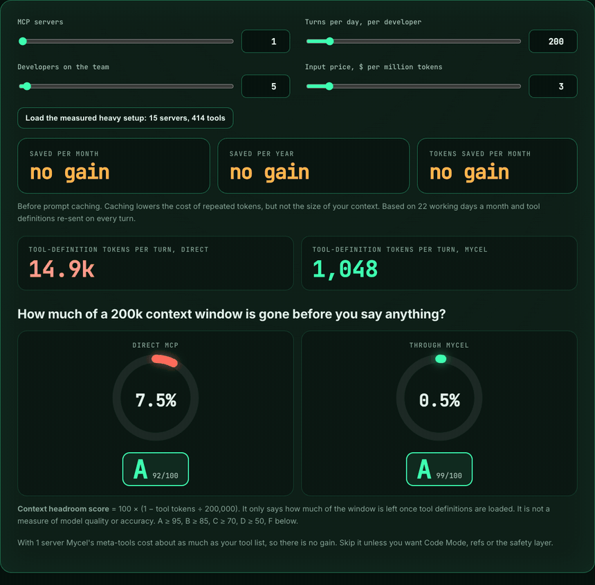
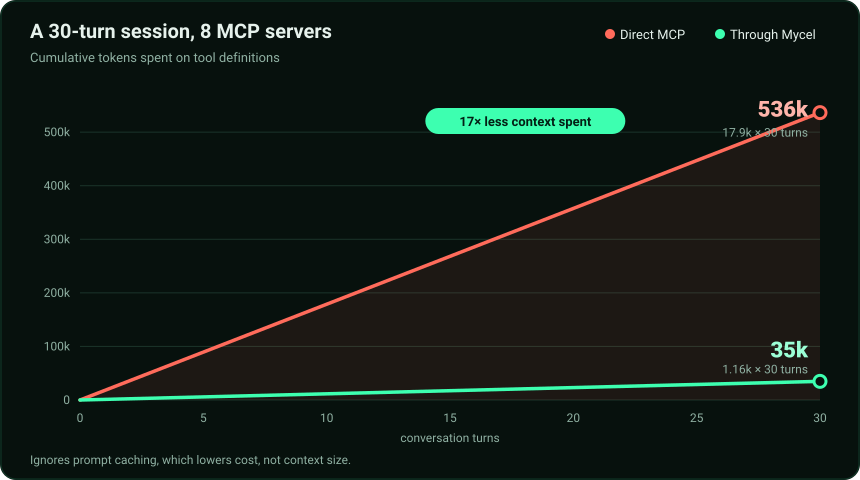
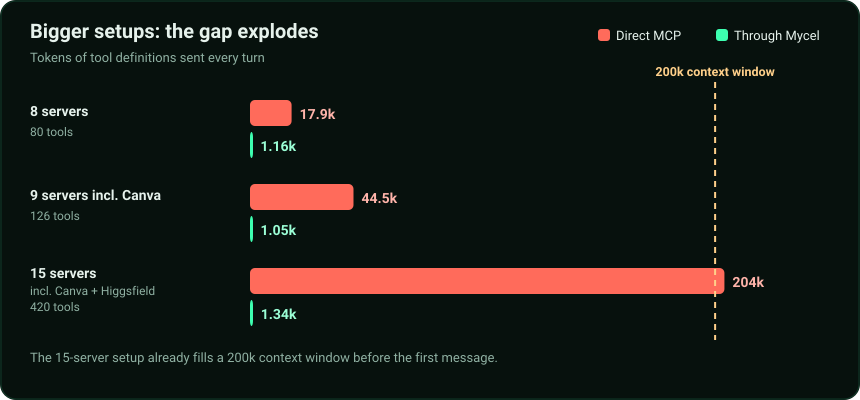
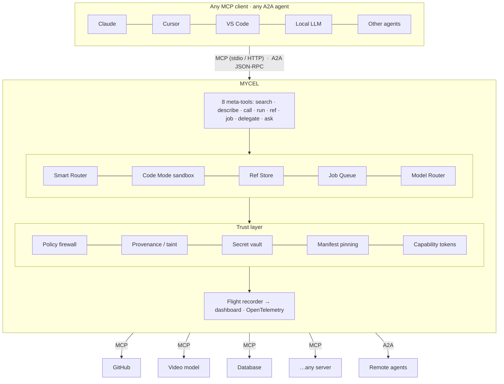

<div align="center">

<a href="https://mycel.speakquery.ai/#film"></a>

<sub>The film is a dramatization. Its 500 MB video example with transcript uses illustrative data (video/data.json); today the built-in video digest returns metadata and keyframe refs, no transcript. The command shown as <code>npx mycel init</code> is <code>npx @speakquery/mycel init</code> (the package is published as @speakquery/mycel).</sub>

# Mycel

### One layer between your agents and everything they touch.

**A drop-in MCP gateway + agent-to-agent mesh.**
Your existing MCP setup — minus the context bloat, the round-trip storms and the blind trust.

[](LICENSE)
[](package.json)
[](https://modelcontextprotocol.io)
[](https://a2a-protocol.org)
[](tests)

[**▶ Watch the 90-second film**](https://mycel.speakquery.ai/#film) · [Quickstart](#-quickstart) · [Benchmark](#-the-numbers) · [How it works](#-how-it-works) · [All 20 features](#-features) · [Docs](docs/)

</div>

---

```bash
mycel init        # finds your Claude / Cursor / VS Code / Windsurf MCP servers and imports them
```

<sub>Install first: `npm install -g @speakquery/mycel` (macOS, Linux, Windows, Node 20+). The command is `mycel`.</sub>

> **Is Mycel a new protocol?** No — and that's the point. Mycel speaks plain **MCP** to your client and plain **MCP** to your servers, so nothing has to change on either side. It also speaks **A2A** so other agents can use your tools under the same rules. Think of it as the missing middle layer both protocols assumed someone else would build.

<p align="center"></p>

<p align="center"><b>▶ Try the interactive savings calculator and 3D view → <a href="https://mycel.speakquery.ai/#calculator">https://mycel.speakquery.ai/#calculator</a></b></p>
<p align="center"><a href="https://mycel.speakquery.ai/#why"></a> <a href="https://mycel.speakquery.ai/#calculator"></a></p>

<h1 align="center">Why use it?</h1>

<h3 align="center">Because every agent with many tools drowns in its own plumbing.</h3>

<p align="center"></p>

- 🧠 **Context bloat.** In clients that send every tool definition on every turn, that is 17.8k tokens for 8 servers and ~204k for 420 tools. Those are tool-definition tokens (~4 chars per token), reproducible offline: [examples/full-scale](examples/full-scale). Less room for your actual work, worse tool choice. Check your client: Claude Code and recent Cursor load tool descriptions on demand.
- 🚚 **Everything flows through the model.** 10,000 rows from tool A to tool B means 10,000 rows in the prompt.
- 🔁 **Round-trip storms.** A 17-step chore means up to 17 inference turns when the client makes one tool call per turn.
- 🎭 **Blind trust.** A web page can tell your agent to write to disk or send your keys; a server can silently rewrite a tool description.
- 🎬 🔑 🕳️ **No home for long jobs, no scoped delegation, no black box.** Video renders time out mid-call, sub-agents inherit every key, and nobody can see what the agent did or what it cost.

<h1 align="center">What do you gain?</h1>

<h3 align="center">Fewer round trips. Big data stays out of the prompt. Unsafe actions get stopped.</h3>

<p align="center"></p>

- ⚡ **17 calls, 1 round trip.** The model writes one small script; Mycel runs it in a WebAssembly sandbox and returns only the result (about +0.4 ms on a Mac, +1 ms in CI (Ubuntu, Windows); median of 15 local calls). 17 tool calls in 1 model round trip. A client that makes one tool call per turn needs 17 turns; an efficient direct path using batch tools (read_multiple_files) needs about 3. Code Mode assumes the model writes a working script first time; not yet measured with a live model.
- 📦 **Refs instead of payloads.** A 20,000-row CSV becomes a reference plus a digest: 131k tokens → 187. The model can still ask for rows or hand the ref to another tool.
- 🛡️ **Safe by default.** Untrusted content can't trigger a write without approval, secrets never enter the model's context, and changed tool definitions are blocked.
- 👁️ **Everything is recorded.** Per-call spans, budgets, approvals and a live dashboard; sub-agents get narrowed capability tokens, never your keys.

<p align="center"></p>

<h1 align="center">How much do you save?</h1>

<h3 align="center">1–2 servers: nothing. 8 servers: ~94%. A big setup: ~99%.</h3>

<p align="center"></p>

- 📉 **8 servers: 17.8k → 1.0k tokens per turn (−94%)**, and a 30-turn session drops from 534k to ~31k.
- 🧰 **Big setups:** 9 servers with Canva is 44.5k → 1.05k; 15 servers / 420 tools is ~204k → ~1.2k (−99.4%). These are tool-definition tokens (~4 chars per token), reproducible offline: [examples/full-scale](examples/full-scale).
- 🔁 **Reproducible:** the −94% with 8 servers is reproducible: examples/field-test (CI runs it on Ubuntu and Windows).
- 📄 **Big results:** a 20,000-row CSV is 131k → 187 tokens.
- ⚖️ **The honest part:** with 1–2 servers Mycel is break-even or slightly worse (−4% / −3%). Skip it there unless you want the safety layer, refs or Code Mode. Details: [Do you need Mycel?](#-do-you-need-mycel)

---

## 📊 The numbers

Measured by `mycel bench` — a reproducible in-process benchmark with 12 realistic servers (GitHub, Slack, Gmail, Calendar, Notion, Linear, Postgres, filesystem, browser, Drive, an AI media studio, Stripe test mode). Token counts use the same estimator (≈ 4 chars/token) on both sides.

| Scenario | Direct MCP | Through Mycel | Saved |
|---|---:|---:|---:|
| Tool definitions in context (167 tools) | **34.8k** tokens | **1.1k** tokens | **96.7%** |
| *"Label every stale issue"* (20 of 40) | 21 round trips · 6,071 tokens | **1 round trip** · 77 tokens | **98.7%** |
| 5,000-row SQL result | 29.7k tokens | 156 tokens (digest + ref) | **99.5%** |
| 8 s 720p video (3.1 MB) | 1,068k tokens as base64 (won't fit) | 117 tokens (metadata + 3 keyframe refs) | **>99.9%** |
| Tool search, offline BM25 (20 English queries) | — | top-1 **18/20** · top-3 **20/20** | — |

<sub>Methodology & caveats: [`src/bench.ts`](src/bench.ts). "Direct" counts only what the model must read; it ignores prompt caching, which lowers cost (not context size) for the direct case. The offline index is English-only today: a reviewer's 8 Turkish queries found 0/8 in the top 3. Models usually search in English; non-English queries are not yet supported.</sub>

## 💰 What you actually save — worked examples

In a client that sends every tool definition on every turn, direct MCP re-sends all of them each time; Mycel stays flat at ~1k tokens. All numbers below are measured (see [Do you need Mycel?](#-do-you-need-mycel) and the [field test](#-field-test-8-real-mcp-servers)), except the dollar line, which is an illustrative assumption.

### 🖱️ Example 1: A client that sends every tool definition each turn: 8 servers, 30 turns

You connect 8 servers (80 tools). A client that sends all 80 definitions (**17.8k tokens**) with every turn spends **17.8k × 30 = 534k tokens** on definitions alone over 30 turns. Through Mycel the model sees ~1.0k tokens per turn: **1.0k × 30 ≈ 31k**. This is arithmetic (17.8k × 30), not a recorded session. Clients that load tools on demand spend less; see [Do you need Mycel?](#-do-you-need-mycel).

<p align="center"></p>

> 💵 *Illustrative assumption, not a measurement:* at $3 per million input tokens, before caching, that is about **$1.60 vs $0.09 per session**. Prompt caching lowers the price of the repeated definitions, but not the space they take in your context window.

### 🧰 Example 2: All 15 servers, 420 tools

Add Canva (44 tools) and Higgsfield (241 tools) to the others and direct MCP needs **~204k tokens of definitions** (tool-definition tokens (~4 chars per token), reproducible offline: [examples/full-scale](examples/full-scale)). In a client that sends them all up front, that is more than a 200k context window **before you type the first message**. Mycel: **~1.2k**. At 9 servers with Canva (126 tools) it is already 44.5k vs 1.05k (−97.6%).

<p align="center"></p>

### 📄 Example 3: Reading a 20,000-row CSV

Direct: the whole file flows through the model, **131k tokens**. Through Mycel the model gets a reference plus a digest (row count, columns, a sample): **187 tokens**. It can still ask for specific rows or pass the ref to another tool without ever reading the file.

### 🔁 Example 4: A 17-step chore, 17 calls in 1 round trip

"Find stale notes and save a report" is **17 tool calls in 1 model round trip** with Code Mode: the model writes one small script and Mycel runs it. A client that makes one tool call per turn needs 17 turns; an efficient direct path using batch tools (`read_multiple_files`) needs about 3. Code Mode assumes the model writes a working script first time; not yet measured with a live model. Per-call overhead of the gateway: **about +0.4 ms on a Mac, +1 ms in CI (Ubuntu, Windows); median of 15 local calls**. And the safe default holds: an untrusted web page trying to trigger `write_file` is **blocked and needs approval**.

**Where it does *not* help:** with 1–2 servers Mycel is break-even or slightly worse (−4% / −3%). Skip it there, unless you want the safety layer, refs or Code Mode.

## 🤔 Do you need Mycel?

Honest answer: **it depends on how many MCP servers your agent uses.** Measured with 8 real open-source servers ([field test](examples/field-test)), adding them one at a time:

| MCP servers | Tools | Tool definitions, direct | Through Mycel | Context saved |
|---:|---:|---:|---:|---:|
| 1 | 3 | 1.1k tokens | 1.1k | **−4%** (small overhead) |
| 2 | 4 | 1.5k | 1.5k | −3% |
| 3 | 18 | 4.7k | 3.8k | 19% |
| **4** | **32** | **6.7k** | **0.9k** | **86%** |
| 6 | 42 | 10.6k | 1.0k | 91% |
| 8 | 80 | 17.8k | 1.0k | **94%** |

Mycel's own footprint stays flat at ~1k tokens. Direct MCP grows with every server you add, and on *every* turn the model re-reads all of those definitions.

**You'll feel it if…**
- you use **4+ MCP servers**, or one big one (Playwright, GitHub, Notion: 20–90 tools each);
- your tools return **big results**: files, tables, logs, page snapshots, images, video. A 20,000-row CSV is 131k tokens direct and 187 through Mycel;
- your agent does **many small steps** (read 15 files, decide, write): Code Mode does it in 1 round trip instead of up to 17 (about 3 with batch tools);
- your agent reads **untrusted content** (web, email, tickets) *and* can write, send or delete;
- you need to **see and cap** what agents do: approvals, budgets, an audit trail, or other agents (A2A) calling your tools.

**You probably don't need it if…** you run 1–2 small servers and only make short, read-only calls. Your client is fine on its own, and Mycel's `auto` mode would just show those tools directly anyway.

**Your client matters too.** Claude Code and recent Cursor versions load MCP tool descriptions on demand (Cursor calls it "dynamic context discovery"). In those clients the definition savings are smaller and not yet measured; Mycel's value there is Code Mode, refs for big results, the safety layer and A2A. Other clients and frameworks may send definitions up front: check your client. The numbers above apply in full only where every definition goes out every turn.

## 🔬 Field test: 8 real MCP servers

`cd examples/field-test && npm install && npm run setup && npm test` runs these checks on your own machine (macOS, Linux or Windows):

| # | Check | Result |
|---|---|---|
| S1 | Tool definitions in context (80 tools) | 17.8k → **1.0k** tokens (−94%) |
| S2 | Startup until tools are listed | about the same as direct (≈0.5–1.5 s) |
| S3 | Offline tool search, 16 natural-language queries | top-3 **15–16/16** depending on the run (English queries), top-1 10/16 |
| S4 | Per-call overhead (median of 15 local calls) | **about +0.4 ms** on a Mac, +1 ms in CI (Ubuntu, Windows) |
| S5 | 20,000-row CSV through `read_text_file` | 131k → **187** tokens (ref + table digest, grep-able) |
| S6 | "Find stale notes, save a report" (17 calls) | 17 calls in **1** round trip (Code Mode; not yet measured with a live model) |
| S7 | Web page (untrusted) → `write_file` | **blocked**, approval required |
| S8 | Browser automation (Playwright) | works, no needless prompts |
| S9 | Images, progress notifications | image → ref, 4/4 progress events forwarded |
| S10 | Risk classes for Playwright's 25 tools | 7 read · 13 external · 5 destructive |

The offline index is English-only today: a reviewer's 8 Turkish queries found 0/8 in the top 3. Models usually search in English; non-English queries are not yet supported.

**Reproducibility:** the −94% with 8 servers is reproducible: examples/field-test (CI runs it on Ubuntu and Windows).

**Plus a real remote server with OAuth:** after `mycel login canva`, Canva's 44 tools work through Mycel, and the tokens refresh automatically. With Canva added, the lab holds 126 tools: **44.5k tokens of definitions direct, 1.05k through Mycel (−97.6%)**.

**At full scale:** 15 servers including Canva and Higgsfield (241 tools on its own), 420 tools in all. The tool definitions cost about **204k tokens direct and 1.2k through Mycel (−99.4%)**. Direct, that would fill most of a model's context window before the first message. These are tool-definition tokens (~4 chars per token), reproducible offline: [examples/full-scale](examples/full-scale). Counted the way clients send tools to the model: name, description and input schema. Canva and Higgsfield also ship output schemas; counting everything `tools/list` returns gives ~400k direct.

The field test found four real bugs before launch. All are fixed and covered by tests:
- Playwright marks even `hover` as destructive. Mycel now cross-checks that label against the tool's name (`annotations: strict` opts out).
- A big text result that came wrapped in JSON lost its table digest.
- grep on a single very long line returned the whole line.
- A few search synonyms were missing.

## 🚀 Quickstart

Works on **macOS, Linux and Windows** (Node 20+). `ffmpeg` is optional (video/audio digests). The servers you bring decide the rest. For example, Python-based servers need [`uv`](https://docs.astral.sh/uv/).

```bash
# Install (the command is `mycel`)
npm install -g @speakquery/mycel

# 1. Import the MCP servers you already use (secrets become {{secret:NAME}} placeholders)
mycel init

# 2. Check everything connects and see your own savings
mycel doctor
mycel bench

# 3. Remote servers with a sign-in (Canva, Notion, Linear, …): once per server
mycel login canva

# 4. Point your client at Mycel instead of N servers
```

<table>
<tr><th>Claude Code</th><th>Claude Desktop / Cursor / Windsurf / VS Code (<code>mcpServers</code>)</th></tr>
<tr><td>

```bash
claude mcp add mycel -- mycel serve
```

</td><td>

```json
{ "mcpServers": { "mycel": { "command": "mycel", "args": ["serve"] } } }
```

</td></tr>
</table>

Open **http://localhost:4747** for the live dashboard. Want the guided tour with real output? → [`examples/demo`](examples/demo).

## 🧬 How it works



The model sees **eight small meta-tools** instead of hundreds of schemas. A typical turn:

```text
mycel_search   {"query": "make a video from a prompt"}
  → [{"tool":"studio.generate_video","effect":"external","async":true,"costUsd":0.4,…}]
mycel_call     {"tool":"studio.generate_video","args":{"prompt":"a fox in neon rain"}}
  → {"status":"job","job":{"id":"job_3f9…","status":"running","progress":42,"total":100}}
mycel_job      {"action":"wait","id":"job_3f9…"}
  → {"status":"succeeded","result":{"ref":"ref://9c1e…","mime":"video/mp4","size":"48.2 MB",
       "digest":{"kind":"video","durationSec":8,"width":1920,"height":1080,"keyframes":["ref://…","ref://…","ref://…"]}}}
mycel_call     {"tool":"studio.upscale_video","args":{"video":{"$ref":"ref://9c1e…","as":"path"}}}
```

48 MB of video moved between two tools. The model read ~120 tokens.

## ✨ Features

All 20 ship in v1. Every one is opt-in beyond the defaults, and a 10-line config works.

### Speed & context
| Feature | What it does |
|---|---|
| **1 · Smart Tool Router** | BM25 search (names ×3, server ×2, descriptions, params, synonyms) over every connected tool. Schemas load only on demand. Modes: `auto` (default — small catalogs get every tool directly plus `run`/`ref`/`job`; past ~4k tokens of definitions it switches to `meta`), `meta`, `hybrid` (meta-tools + your top-N most-used tools directly), `passthrough`. |
| **2 · Code Mode** | The model writes one async JS script; it runs in a **QuickJS WebAssembly sandbox** (no fs, no network, no Node APIs, CPU/memory/call caps). Only the return value comes back. `Promise.all` works. |
| **3 · Ref Store** | Content-addressed (`ref://<sha256>`) storage for anything big or binary, with model-sized **digests**: JSON shape + sample, table columns + stats, text outline, image/video/audio metadata, video keyframes (ffmpeg). Pass refs straight into tool args as text, JSON, base64, data URL or file path. |
| **4 · Job Queue** | Slow tools become jobs: progress, cancel, retry with backoff, **provider fallback chains**, resume after restart (idempotent jobs only — nothing runs twice by surprise). |
| **5 · Cost & Budget** | Per-tool cost/latency contracts, `dryRun` estimates, per-task / per-day / per-token spend caps. Tools without a declared cost count as $0; set `cost` per tool for budgets to be meaningful. |
| **15 · Model Router** | `mycel_ask` hands self-contained sub-tasks (summarise, extract, classify) to a `fast`/`balanced`/`deep` tier — any OpenAI-compatible endpoint (Ollama, vLLM, LM Studio, OpenRouter…) or Anthropic. Refs in the prompt are expanded for the sub-model, not your main context. |

### Trust
| Feature | What it does |
|---|---|
| **6 · Tool Contracts** | Every tool gets an effect class — `read` · `write` · `external` · `destructive` — plus idempotency, cost, latency, async. Inferred from MCP annotations and names (cautiously), overridable in config. |
| **7 · Policy Firewall** | Ordered YAML rules: `allow` / `deny` / `approve` by tool glob, server, effect or taint. Safe defaults: destructive → approve; tainted + side-effect → approve. |
| **8 · Provenance & Taint** | Output from `trust: untrusted` servers is labelled and **taint follows the data** — through refs and through code-mode scripts. A script that read a hostile web page can't quietly send email. |
| **9 · Secret Vault** | The model only ever sees `{{secret:GITHUB_TOKEN}}`. Real values are injected at call time and scrubbed from every output, error and trace. |
| **10 · Manifest Pinning** | Tool definitions are hashed into `mycel.lock`. If a server silently changes a tool's description or schema (a "rug pull"), the tool is blocked until a human runs `mycel pin --accept`. |
| **14 · Capability Tokens** | Macaroon-style, attenuable, expiring delegation tokens (`myc1.…`). A sub-agent can narrow its token — fewer tools, lower effect ceiling, smaller budget, shorter expiry — and hand it on, but can **never** widen it. No secret needed to attenuate. |
| **Approvals** | Inline via MCP **elicitation** when the client supports it; otherwise an approval id the human grants with `mycel approve <id>` or one click in the dashboard. Approvals are one-shot and bound to the exact arguments. |

### Visibility
| Feature | What it does |
|---|---|
| **11 · Flight Recorder** | Every search, call, script, job, approval and policy decision is a span: timing, tokens saved, bytes offloaded, cost, taint. JSONL on disk + **OpenTelemetry (OTLP/HTTP)** export. `mycel replay <trace>`. |
| **12 · Live Dashboard** | Local web UI: savings, live activity, trace waterfalls, approvals, jobs, servers, drift, refs. Token-protected and DNS-rebinding-safe. |

### Mesh & integration
| Feature | What it does |
|---|---|
| **13 · A2A Bridge** | Mycel *is* an A2A agent (Agent Card at `/.well-known/agent-card.json`, `message/send`, `tasks/get`, `tasks/cancel`) **and** an A2A client (`mycel_delegate` to your peers). Same policy, budget, taint and recording for agents as for MCP clients. |
| **16 · Universal import** | `mycel init` reads Claude Desktop, Claude Code (incl. per-project), Cursor, VS Code, Windsurf and Gemini CLI configs. |
| **17 · Both transports** | Serve over stdio (desktop clients) or Streamable HTTP (`/mcp`, teams/remote). Upstreams over stdio or HTTP. |
| **18 · Python client** | `pip install "git+https://github.com/SpeakQuery/mycel#subdirectory=python"` — zero dependencies. |
| **19 · Benchmark** | `mycel bench` — the numbers above, reproducible on your machine. |
| **20 · Adapter SDK** | `defineAdapter({...})` turns ~50 lines into a provider (a new video model, an internal API) that works in-process *and* as a standalone MCP server. |

## ⚙️ Configuration

`mycel.yaml` (generated by `mycel init`):

```yaml
servers:
  github:
    command: npx
    args: ["-y", "@modelcontextprotocol/server-github"]
    env: { GITHUB_TOKEN: "{{secret:GITHUB_TOKEN}}" }
  canva:
    url: https://mcp.canva.com/mcp          # OAuth: run `mycel login canva` once; tokens refresh automatically
  studio:
    url: https://studio.example.com/mcp
    headers: { Authorization: "Bearer {{secret:STUDIO_KEY}}" }
    tools:                                  # contract overrides
      generate_video: { async: true, costUsd: 0.40, fallback: ["backup.generate_video"], retries: 1 }
  web:
    command: node
    args: ["./web-server.mjs"]
    trust: untrusted                        # its output is labelled and taints downstream calls

router:  { mode: auto }                     # auto | meta | hybrid | passthrough
policy:
  - match: { tool: "github.*delete*" }
    action: deny
  - match: { effect: destructive }
    action: approve
  - match: { tainted: true, effect: external }
    action: approve
    reason: Untrusted content is trying to send something out.
budget:  { perTaskUsd: 5, perDayUsd: 50 }
refs:    { inlineLimitBytes: 8000 }
sandbox: { timeoutMs: 30000, memoryMb: 64, maxToolCalls: 200 }
jobs:    { asyncThresholdMs: 20000, concurrency: 4 }
recorder: { otlpEndpoint: http://localhost:4318 }   # optional
models:                                     # optional, enables mycel_ask
  fast:     { provider: openai, baseUrl: http://localhost:11434/v1, model: llama3.2 }
  balanced: { provider: anthropic, model: claude-haiku-5-5, apiKey: "{{secret:ANTHROPIC_API_KEY}}" }
a2a:                                        # optional
  tokenSecret: "{{secret:MYCEL_TOKEN_SECRET}}"
  peers:
    researcher: { url: https://research.example.com, token: "{{secret:RESEARCHER_TOKEN}}" }
```

Full reference: [`docs/configuration.md`](docs/configuration.md).

## 🧪 Code Mode

```js
// mycel_run — one round trip instead of 21
const issues = await tools.call("github.list_issues", { repo: "acme/web", state: "open" });
const stale = issues.filter(i => daysSince(i.updated_at) > 30);
await Promise.all(stale.map(i => tools.call("github.add_label", { repo: "acme/web", issue: i.number, label: "stale" })));
return { labelled: stale.length };
```

Sandbox API: `tools.call(id, args)`, `tools.search(q)`, `refs.read(ref, {path, rows, grep, offset, length})`, `refs.put(value)`, `jobs.run(tool, args)`, `jobs.submit / wait`, `ask(prompt, {tier})`, `console.log`, `sleep`, `daysSince`, `chunk`, `pick`. Every `tools.call` goes through the same policy, budget, taint and recording as a direct call.

## 🤝 Agent to agent

```bash
export MYCEL_TOKEN_SECRET=$(mycel token secret)
mycel serve --http --port 4747                       # MCP at /mcp, A2A at /a2a

# Give a research agent read-only GitHub access for 2 hours, max $1
TOKEN=$(mycel token mint --tools 'github.*' --max-effect read --budget 1 --ttl 2h --sub researcher)
# …which it can narrow further for its own sub-agent — but never widen
mycel token attenuate "$TOKEN" --tools 'github.list_*' --ttl 10m --sub summarizer
```

```bash
curl -s localhost:4747/a2a -H "authorization: Bearer $TOKEN" -H 'content-type: application/json' -d '{
  "jsonrpc":"2.0","id":1,"method":"message/send",
  "params":{"message":{"kind":"message","role":"user","messageId":"1",
    "parts":[{"kind":"data","data":{"tool":"github.list_issues","args":{"repo":"acme/web"}}}]}}}'
```

A destructive request comes back as `input-required` with an approval id; after a human approves, the agent resumes the same task. See [`examples/a2a`](examples/a2a).

## 🐍 Python

```python
from mycel_client import Mycel, ApprovalRequired

m = Mycel("http://127.0.0.1:4747")
print(m.search("make a video"))
issues = m.call("github.list_issues", {"repo": "acme/web"})
print(m.run("return (await tools.call('github.list_issues', {})).length"))
```

## 🔌 Write an adapter

```js
import { defineAdapter, file } from "mycel";

export default defineAdapter({
  name: "my-video-model",
  tools: [{
    name: "generate_video",
    description: "Generate a video from a prompt",
    input: { type: "object", properties: { prompt: { type: "string" } }, required: ["prompt"] },
    effect: "external", async: true, costUsd: 0.4,
    async run({ prompt }, { progress }) {
      const id = await startRender(prompt);
      for (let p; (p = await poll(id)).status !== "done"; ) progress(p.percent, 100);
      return file(await download(id), "video/mp4", "out.mp4");   // becomes a ref:// with keyframes
    },
  }],
}).serve();                                                    // a standalone MCP server, too
```

## 🖥️ CLI

| Command | |
|---|---|
| `mycel init` | import client configs → `mycel.yaml` |
| `mycel serve [--http]` | run the gateway (stdio, or HTTP with `/mcp` + `/a2a`) |
| `mycel dashboard` | open the local dashboard |
| `mycel doctor` · `mycel bench` | check setup · measure savings |
| `mycel login <server>` | sign in to a remote MCP server that uses OAuth (Canva, Notion, Linear, …) |
| `mycel search <q>` · `mycel call <tool> [json]` · `mycel run <file>` | use tools from the terminal, same rules as agents |
| `mycel approvals` · `approve <id>` · `deny <id>` | human-in-the-loop |
| `mycel pin [--accept]` | review / accept tool-definition drift |
| `mycel token secret / mint / attenuate / inspect` | capability tokens |
| `mycel traces` · `mycel replay <id>` | flight recorder |
| `mycel refs [--gc 7d]` | ref store |

## 🛡️ Security model — honestly

Mycel **reduces and exposes** risk; it does not "solve" prompt injection. What it guarantees: secrets never enter the model's context; destructive and tainted side-effects need a human by default; changed tool definitions are blocked; delegated agents can't exceed their token; everything is recorded. What it can't guarantee: that a trusted server is actually trustworthy, or that a model never misreads data as instructions. Code Mode runs in QuickJS/WASM with no ambient capabilities, but treat it as defence in depth, not a security boundary for hostile code. Report issues: [SECURITY.md](SECURITY.md).

## 🗺️ Roadmap

- Streaming refs for realtime audio/video agents
- Embedding-based search as an optional plug-in (BM25 stays the offline default)
- A2A streaming (`message/stream`) and push notifications
- Signed tool manifests from server publishers
- Team mode: shared policy, approvals routed to Slack/Teams

## Contributing

PRs welcome — see [CONTRIBUTING.md](CONTRIBUTING.md). `npm install && npm test` runs the full suite (47 tests) in a few seconds.

## License

[Apache-2.0](LICENSE) © The Mycel Authors
